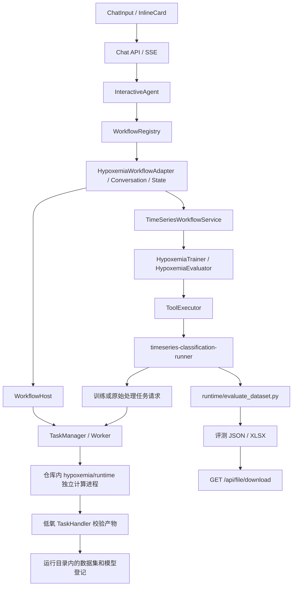

# 低氧血症架构与扩展说明

界面步骤见[使用指南](hypoxemia-operation-guide.md)，安装见[运行环境](hypoxemia-runtime-and-delivery.md)，实际验证及边界见[验收记录](pr-readiness.md)。

## 调用链与职责

平台环境承担 API、工作流和资源登记。计算环境承担 NumPy/pandas 数据处理及 PyTorch 训练和评测；它只加载随仓库交付的低氧源码，不加载平台配置，也不接收平台 LLM Key。平台通过解释器绝对路径启动计算进程，用户不需要激活或切换计算环境。

`core/workflow`、`core/task`、`core/timeseries`、`core/runtime` 继续提供通用机制。通道、标签、阈值、预处理及模型配置属于 `resources/workflows/hypoxemia` 和其专用工具。领域任务处理器可提供子进程环境；通用 Worker 不判断低氧模型或医学阈值。

## 随仓库交付的计算组件

| 文件或目录（相对于 hypoxemia/runtime） | 作用 |
| --- | --- |
| `scripts/run_tslib_classification_trial.py` | 优化器、短训练、验证集选阈值、checkpoint 与报告保存 |
| `scripts/tslib_classification_common.py` | 严格数据加载、分组划分、标准化、模型实例化、指标 |
| `scripts/tslib_local_models.py` | 现有五通道目录需要的研究模型及共享分类头，排除波形/多分支实验模型 |
| `raw/run_dedup_pipeline.py` | CSV 列识别、按设备去重、连续段预处理、低氧标签和窗口提取 |
| `raw_zip_pipeline.py` | ZIP 安全展开、临时目录、调用原始处理入口、检查非空结果 |
| `evaluate_dataset.py` | 加载所选模型权重和训练 scaler，在所选数据集验证划分上评测 |
| `scripts/provenance.py` | 记录实际加载的自有/模型模块、文件 SHA-256、解释器和包版本 |
| `vendor/Time-Series-Library` | 现有五通道目录所需模型、层和工具的导入闭包；不含数据、训练权重、上游实验入口 |

旧工具目录中的计算脚本仅作为兼容入口。`SPO2_HYPOXEMIA_PROJECT`、`SPO2_HYPOXEMIA_PIPELINE_SCRIPT` 和 `SPO2_HYPOXEMIA_PYTHON` 不再用于选择计算源码或环境，可以从本地配置中删除。管理员可通过 `SOTABAND_HYPOXEMIA_PYTHON` 显式覆盖解释器；默认使用安装流程创建的 `.venv-hypoxemia`。

## 数据和模型契约

- 数值通道顺序固定为 `SpO2, HR, PR, RR, PI`；窗口元数据可在最前面包含 `Time`。
- 当前低氧适配器只接受 1 Hz。默认回看 256 秒，预测间隔 30 秒；配置窗口长度必须与每个实际窗口严格一致。
- `window_features.pkl` 与 `window_info.pkl` 数量一致且非空；必须有 `window_stats.json` 或 `dataset_manifest.json` 声明采样率和长度。两份声明同时存在时必须一致。
- 逐窗口核验列顺序、形状、有限数值和标签；训练与评测共用严格加载器。不会通过补齐、裁剪、默认换列或把未知标签当阴性来生成结果。
- 原始预处理默认阈值 94，预处理判断 `<94`，窗口判断 `<=94`，事件持续 20 秒；参数保存在处理配置与数据集清单中。
- 默认按 `group_id` 划分，seed=42，验证/测试各 15%；缺少分组拒绝运行。scaler 只在训练集拟合，评测加载保存的 scaler。
- 默认评测当前所选数据集的验证划分，复用训练时的划分方式、比例、seed 和验证集阈值。此结果不能替代独立测试集或临床效能验证。

模型产物包括 `best_model.pt`、`scaler.pkl`、`tslib_model_config.json`、`threshold_report_f1.json`、`manifest.json` 和 `runtime_provenance.json`。`SOURCE.json` 说明的是模型实现代码版本；`best_model.pt` 是一次训练的权重，二者不能互相替代。

任务 ID 对应运行目录和模型 manifest；保存模型后产生模型资源 ID，并记录训练任务和数据集 ID。重新选择模型必须解析其登记的真实权重路径。评测记录模型 ID、数据集 ID、数据路径、模型路径、阈值与划分范围；Excel 同时包含来源信息和指标。

## 运行状态与存储

运行目录由 `SOTABAND_RUNTIME_ROOT` 配置，默认 `.runtime/refactor`。任务、模型登记、数据登记、原始处理结果、评测及下载文件都属于运行数据。源码和 vendor 目录不作为输出目录。新运行目录只允许从静态目录初始化可移植的资源配置，不导入历史训练记录或绝对模型/数据路径。

任务领取在登记锁内完成，只有一个 Worker 能领取 queued 任务；终态不被覆盖。启动失败写入 failed，取消终止工作进程及计算进程树，完成处理期间阻止取消破坏产物登记。模型保存和完成处理保持幂等。

pickle 和 PyTorch checkpoint 只用于受信任的本地研究数据与模型。受信任数据根目录由 `SPO2_HYPOXEMIA_TRUSTED_DATA_ROOTS` 声明，平台运行根目录默认受信任。这一变量与已废弃的外部源码路径变量无关。

## 扩展

新增低氧模型应在领域目录增加实现、依赖声明和目录项，并验证固定通道契约、权重重载及失败分支。依赖升级后重新生成锁文件并运行验收脚本。其他领域应实现自己的 WorkflowAdapter、Trainer/Evaluator 和 TaskHandler，复用通用任务及资源接口，不修改通用 Agent 来添加医学规则。

沿用单机静态工作流挂载方式；多实例任务调度、进程被操作系统强杀后的自动恢复、实时报警和在线单窗口预测不在本次交付范围内。
