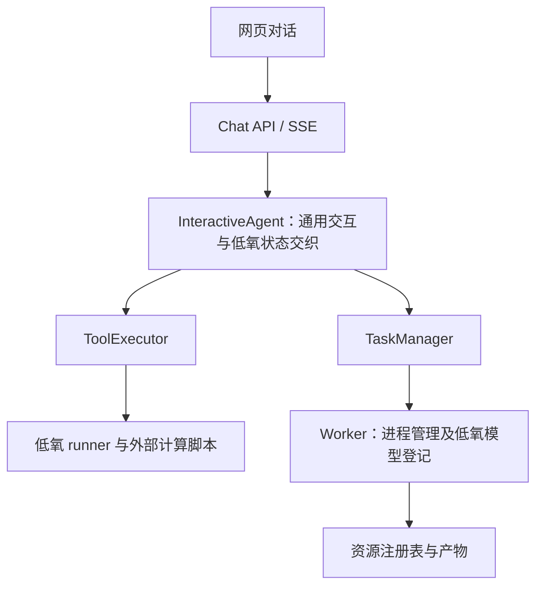
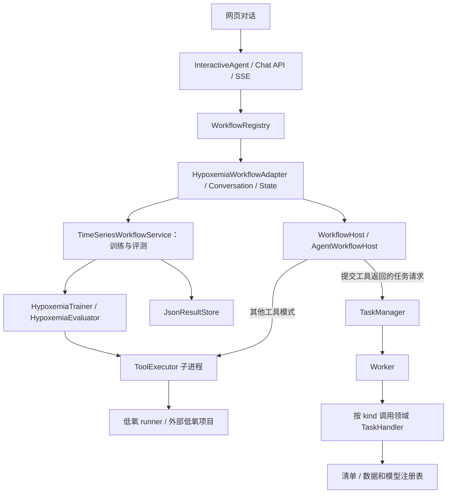

# SOTABand 重构版对比与后续开发说明

编写日期：2026-10-10。代码快照：`b24c000`，分支 `refactor/timeseries-workflow`。本文新增及修订的文档不计入该快照的代码量。

> 本文的代码量、91 项测试和待修复列表均以 `b24c000` 为历史快照。后续 PR 修复已补齐模型引用、兼容性检查和任务状态保护；当前实测 105 项单元测试及一次合成数据短训练评测。最新验收范围见 [PR 验收记录](pr-readiness.md)。

本文面向项目负责人和开发者。平台使用者请阅读[低氧血症操作指南](hypoxemia-operation-guide.md)，部署人员请阅读[部署与维护说明](hypoxemia-admin-guide.md)。

## 1. 对比的是哪三个版本

| 版本 | 提交 | 对照标记 | 含义 |
| --- | --- | --- | --- |
| 原始对照版 | `a0c8cd2` | `pre-baseline-20261007` | 本仓库保存的原始提交状态 |
| 低氧可运行基线 | `a6bcc0e` | `hypoxemia-baseline-v1` / `hypoxemia-baseline-20261007` | 在迁移前保存的可运行低氧工作流 |
| 当前重构版 | `b24c000` | `refactor/timeseries-workflow` | 基线之后增加 21 个提交的版本 |

这里的“原始 SOTABand”严格指 `a0c8cd2`，不代表从网络重新下载的某个上游发行版。该提交已经包含低氧专用工具、时序交互分支和后台任务能力，不能把它们全部算作本次从零新增。

当前两个工作目录分别是 `D:\code\SOTABand`（基线）和 `D:\code\SOTABand-refactor`（重构版）。本次文档保存在重构目录，基线用于对照。

## 2. 代码量增加了多少

### 2.1 统计口径

统计 Git 提交内的文件，不扫描工作区中的虚拟环境、依赖安装目录、未跟踪文件或实际训练输出。按物理行计数，包含注释与空行，不是剔除注释后的有效语句数。

- 源码：扩展名为 `.py`、`.ts`、`.tsx`、`.js`、`.jsx`、`.mjs`、`.cjs`、`.css`、`.html`，且不在 `tests/` 下；包括源码形式的配置文件。
- 测试：`tests/` 下具有上述扩展名的文件。
- 其他：文档、JSON、锁文件、环境变量模板等，单独列出，不称为源码。
- 含 NUL 字节的文件按二进制排除；外部低氧项目及其 Time-Series-Library 不在统计范围内。

### 2.2 三个版本的存量

| 指标 | 原始 `a0c8cd2` | 低氧基线 `a6bcc0e` | 当前 `b24c000` |
| --- | ---: | ---: | ---: |
| 源码文件数 | 223 | 225 | 251 |
| 源码行数 | 38,771 | 41,302 | 43,383 |
| 测试文件数 | 7 | 7 | 14 |
| 测试行数 | 381 | 941 | 1,637 |
| 源码与测试合计 | 39,152 | 42,243 | 45,020 |

相对原始版本，当前**源码净增加 4,612 行，约 11.9%**；测试净增加 1,256 行。两者合计净增加 **5,868 行，约 15.0%**。

相对低氧基线，重构阶段源码净增加 **2,081 行，约 5.0%**，测试净增加 696 行，合计净增加 2,777 行。

### 2.3 新增行、删除行与净增长

| 对比 | 范围 | 新增 | 删除 | 净增加 |
| --- | --- | ---: | ---: | ---: |
| 原始 → 当前 | 源码 | 5,483 | 871 | 4,612 |
| 原始 → 当前 | 测试 | 1,279 | 23 | 1,256 |
| 原始 → 当前 | 其他文本 | 3,644 | 5 | 3,639 |
| 原始 → 当前 | Git 全部文本差异，74 个文件 | 10,406 | 899 | 9,507 |
| 基线 → 当前 | 源码 | 4,435 | 2,354 | 2,081 |
| 基线 → 当前 | 测试 | 732 | 36 | 696 |
| 基线 → 当前 | 其他文本 | 67 | 0 | 67 |
| 基线 → 当前 | Git 全部文本差异，59 个文件 | 5,234 | 2,390 | 2,844 |

“新增 10,406 行”不等于“新增 10,406 行程序”。例如原始到当前的任务注册表就有 2,308 行新增，模型注册表有 613 行新增，均属元数据。跨文件搬迁也会同时计入新增和删除，不能用差异行数直接衡量新功能数量或开发质量。

### 2.4 代码主要去了哪里

以下只统计源码和测试扩展名；目录行与单文件行用于说明分布，不应再加到总量上。

| 位置 | 原始 | 基线 | 当前 | 变化含义 |
| --- | ---: | ---: | ---: | --- |
| `interactive_agent/agent.py` | 1,674 | 3,106 | 1,195 | 平台 Agent 中的领域交互移出 |
| `resources/workflows/` | 0 | 0 | 2,946 | 集中承接领域工作流与宿主适配 |
| `core/workflow/` | 0 | 0 | 213 | 工作流接口、注册、宿主协议、结果衔接 |
| `core/timeseries/` | 0 | 0 | 342 | 时序请求、组合服务、资源与结果组件 |
| `core/runtime/` | 0 | 0 | 176 | 重构运行目录与路径入口 |
| `core/task/` | 273 | 344 | 282 | 领域完成逻辑移入任务处理器 |
| 低氧 runner 目录 | 803 | 1,623 | 1,677 | 数据处理、评测脚本及现有执行入口 |
| `frontend/` | 13,138 | 13,341 | 13,527 | 数据选择、模型分组、任务与结果交互 |
| `tests/` | 381 | 941 | 1,637 | 工作流、任务、注册表等回归覆盖 |

重构减少了平台 Agent 的体积，但没有消除业务复杂度：当前 `hypoxemia/conversation.py` 仍有 2,221 行，runner 的 `tool.py` 仍有 1,352 行。后续应按交互阶段和执行能力继续拆分，而不是继续扩大这两个文件。

## 3. 这一版改进了什么

| 方面 | 原始/基线状态 | 当前实现与收益 | 边界 |
| --- | --- | --- | --- |
| 领域交互 | 低氧选择、参数收集等集中在平台 Agent | 工作流注册表路由到低氧 adapter；平台代码不再按低氧工具 ID 写业务分支 | 仍是静态注册 |
| 平台能力调用 | 业务逻辑与 Agent 内部方法交织 | `WorkflowHost` 声明公开能力，`AgentWorkflowHost` 包装现有 Agent | 包装器内部仍调用旧私有方法 |
| 训练与评测入口 | 由交互层直接走工具执行 | 主页训练与评测实际经过 `TimeSeriesWorkflowService` | 数据处理、模型管理等尚未全部走该服务 |
| 任务完成 | Worker 理解低氧模型注册规则 | Worker 按 `kind` 调用领域任务处理器 | 任务恢复、幂等性仍需补足 |
| 成功判定 | 可能在训练命令结束后缺少完整产物检查 | 检查权重、scaler、配置、阈值报告，完成处理成功后才标记完成 | 不等于已验证模型统计质量 |
| 数据资源 | 文件输出与注册资源衔接较弱 | 原始处理成功后检查窗口输出、写清单并注册数据集 | 多配置输出的完整登记仍需验证 |
| 模型资源 | 架构配置与训练产物容易混淆 | 增加分组与明确的保存选择；保存配置和保存训练模型分成两步 | 配置、运行、产物尚未完全独立建模 |
| 结果留存 | 依赖工具返回和报告文件 | JSON 结果保存并返回 `result_id`，预留模型/数据/任务来源 | 部分路径来源 ID 仍可能为空，历史浏览页尚不完整 |
| 文件并发写入 | 多处直接读写 JSON | 任务、数据、模型主要修改路径使用进程锁和原子替换 | 仍有直接写注册表的路径；没有跨表事务 |
| 双版本运行 | 容易读写相同任务和训练输出 | 默认 `.runtime/refactor`，前后端使用独立端口 | 外部项目、源数据及部分资源定义仍是外部/静态依赖 |
| 网页操作 | 依赖输入路径，保存和评测选项混在一起 | 可选已注册数据、上传配套文件或目录；训练后独立决定保存；Excel 单独选择 | 尚需面向普通用户的浏览器验收 |

相对 `a0c8cd2`，中间的低氧基线还增加了原始 ZIP 处理、对选定数据重新评测、参数编辑卡、评测展示/导出等功能。这些应归入“原始到当前”的累计改进，不应全算成“基线到当前”的重构成果。

## 4. 架构有什么变化

### 4.1 保留的基础

平台继续采用 FastAPI 后端、React 前端、SSE 对话输出、资源注册表和工具子进程。没有引入微服务、分布式任务队列或新的数据库。原项目 README 中的分布式愿景不能视为本版已实现的能力。

### 4.2 迁移前



### 4.3 当前真实调用关系



训练服务的 `submit_training()` 当前返回工具构造的任务请求，真正启动后台任务仍由交互层经宿主完成。直接调用该方法并不等于后台训练已经开始。评测当前在工具子进程中等待计算结果，没有与训练相同的持久任务生命周期。

核心变化是**职责分离和可替换的调用边界**。新增领域可以挂接工作流；特定算法仍由具体工具和外部项目实现。

## 5. 新模块及扩展程度

| 模块/入口 | 当前职责 | 后续如何使用 |
| --- | --- | --- |
| [`core/workflow/base.py`](../core/workflow/base.py) | `WorkflowAdapter`、`WorkflowContext` | 实现领域识别和事件输出 |
| [`core/workflow/registry.py`](../core/workflow/registry.py) | 注册、匹配、会话归属 | 统一选择 adapter，避免在 Agent 加领域判断 |
| [`core/workflow/host.py`](../core/workflow/host.py) | 工作流可调用的平台能力 | 调用工具、提交任务、生成回复等 |
| [`resources/workflows/host.py`](../resources/workflows/host.py) | 现有 Agent 的宿主适配 | 让旧 Agent 能实现上述协议 |
| [`core/timeseries/`](../core/timeseries/) | 请求引用、服务、目录/产物/结果组件及 manifest | 组合不同 trainer/evaluator 等组件 |
| [`resources/workflows/hypoxemia/`](../resources/workflows/hypoxemia/) | 低氧意图、阶段、参数、规则、计算绑定、完成处理 | 修改低氧业务时的主要位置 |
| [`core/task/handlers.py`](../core/task/handlers.py) | 任务生命周期处理器注册 | 新长任务提供成功、失败、取消等回调 |
| [`core/runtime/paths.py`](../core/runtime/paths.py) | 隔离的运行路径 | 新产物通过公共路径函数定位 |
| [`core/resource/registry/json_store.py`](../core/resource/registry/json_store.py) | 锁内修改和原子替换 JSON 列表 | 通过注册表 API 或该事务入口更新 |

`core/workflow/state_store.py` 虽已存在，但只是内存实现，低氧主流程仍维护自己的内存状态字典。`LocalDatasetProcessor` 目前只检查路径，不提供通用时序格式、患者划分和采样率校验。`LocalArtifactStore` 管理文件引用/复制，不等于模型加载推理引擎。

**低氧功能已成为静态、进程内的领域工作流插件。** 工作流与任务处理器分别在 `resources/workflows/__init__.py` 和 `resources/workflows/task_handlers.py` 组装。尚未实现可独立安装的插件包、自动发现、版本协商或热插拔。当前默认构造仍可以导入全局 Agent，服务依赖也在 adapter 内组装，独立复用仍需完善注入。

## 6. 后续功能应该怎样开发

### 6.1 先判断功能属于哪一层

| 需求 | 应修改的位置 | 验收重点 |
| --- | --- | --- |
| 新增一次输入一次输出的工具 | `resources/tools/implementations/<tool-id>/`、工具规范和注册入口 | 参数、工具结果、错误与依赖 |
| 低氧新增阶段/参数/选择项 | `resources/workflows/hypoxemia/`，必要时更新 runner 的规范与校验 | 状态转移、上下文保持、卡片字段 |
| 新增心电、睡眠等领域流程 | 新建 `resources/workflows/<domain>/`，实现 adapter，静态挂载 | 识别不抢占其他流程、会话隔离、完整主链路 |
| 更换训练后端/评估器 | 领域组件实现，加到服务组装处；必要时先补组件 Protocol | 同一请求契约下返回相容结果 |
| 新增可执行网络架构 | 外部模型实现与目录、参数 schema、领域候选项 | 真正实例化、短训练、权重保存与重新加载 |
| 新增长任务及产物登记 | `TaskManager` + 新领域 `TaskHandler` | 成功/失败/取消、缺产物、重复完成 |
| 新的模型/数据通用管理能力 | `core/resource/registry/`、`app/api/routes/` | ID 唯一性、并发、权限与兼容 |
| 新结果卡/历史结果页 | 前端卡片与类型、结果查询 API | 前后端协议一致、空值/失败/下载 |

只添加模型名称或让大模型写一段设计说明不会产生可训练的新网络。新领域也不能直接复用低氧五通道假设；通道、采样、标签、划分方法和指标必须由自身实现定义。

### 6.2 新领域工作流的落地步骤

1. 写出输入、输出、交互阶段和失败恢复规则，确定哪些是领域规则、哪些可复用平台能力。
2. 在 `resources/workflows/<domain>/` 实现 `WorkflowAdapter.detect()` / `handle()`，设置唯一 `workflow_id` 和明确的 `tool_ids`。优先复用已存在的卡片事件。
3. 显式接收宿主依赖；在 `resources/workflows/__init__.py` 的工厂中构造并注册。识别词要体现领域，不要仅凭“训练”“模型”占用任何会话。
4. 若使用时序计算，实现该领域的数据校验、trainer、evaluator 并组合服务。不要将 SpO2 阈值或五通道规则搬到 `core/timeseries/`。
5. 长任务返回 `task_request`，由宿主提交；使用诸如 `ecg-training` 的独立任务类型，在 `resources/workflows/task_handlers.py` 注册处理器。Worker 子进程也必须能加载该注册代码。
6. 明确数据 ID、模型 ID、运行 ID、产物目录、结果 ID 的来源。产物写清单，成功处理返回元数据；重复完成处理应指向同一个资源。
7. 对工作流主链、错误输入、任务失败/取消、保存和结果复用做验收，更新用户指南与维护说明。

不要直接复制 2,221 行的低氧 conversation 作为新领域模板。它包含迁移兼容逻辑；新流程应从最小 adapter 起步，再把真正相同的交互能力提取成公共组件。

### 6.3 当前开发时必须了解的缺口

- `ModelRef.artifact_path` 尚未由低氧 evaluator 完整映射，runner 也不能保证仅凭 `model_id` 解析正确产物。现有调用需显式传递并核对产物路径；统一 resolver 应优先补齐。
- 实际数据集评测没有完整比较两侧 manifest，计算脚本可能自动裁剪或补齐长度。不能宣称“不兼容数据必然被拒绝”。先实现兼容性检查，再扩展不同采样率和通道的模型。
- 原始目录直接进入评测时，`dataset_id` 可能未传递；结果落盘不代表来源关联已完整。
- 任务启动失败、终态重复执行、PID 管理、旧元数据兼容和完成处理幂等仍需完善；不要假设有自动重试和崩溃恢复。
- 会话状态在单进程内，重启会丢失；未完成多 worker/多实例一致性。主要注册表加锁不等于所有写路径都安全。
- `predict` 仍是失败占位入口。当前可用主流程是离线数据处理、模型训练与评测，不能标称已提供实时预警或单样本在线预测。

优先级建议：先保证模型/数据引用与评测兼容性，再补任务恢复与幂等，之后做状态持久化和历史查询。出现实际插件分发需求时再实现动态发现；单机阶段不必先引入微服务。

### 6.4 分支、提交与验证

新功能从重构版的最新稳定提交创建 `feat/<主题>`，修复创建 `fix/<主题>`。保留基线分支做对照。一次 commit 表达一个可理解、可验证的变化，避免把实验产物和源码一起提交；不要仅按文件数量拆提交。

功能边界、测试和说明完整后创建 PR；跨模块改动可较早创建草稿 PR。PR 写清触发问题、改变后的行为、验证结果和未覆盖范围。没有远程协作时仍可以使用本地分支与 commit，并非必须创建 PR 才能开发。

本次对照前的最近一次验证：2026-10-09，`b24c000` 的 `tests/unit` **91 项通过**。这不等于 91 条完整用户旅程，也不证明真实训练、浏览器、多进程并发都已验收。

```powershell
# 在配置好的平台 Python 环境中执行
python -m pytest tests/unit -q -p no:cacheprovider
# 涉及前端时，在 frontend 目录执行
npm run build
```

新功能还应执行与其相关的真实流程，例如一轮短训练、指定数据集评测、浏览器上传与 Excel 下载。本次仅更新文档，没有重新运行训练或浏览器流程。

## 7. 为什么要修改用户操作指南

旧版指南把 PowerShell、虚拟环境、环境变量、SSE 实测、运行目录和网页操作放在一起，零计算机基础使用者难以判断自己应做什么。还存在以下与 `b24c000` 不一致的内容：

| 旧说明 | 当前事实及修订 |
| --- | --- |
| 使用 5173/8001 启动重构版 | 重构默认使用 5174/8002；普通用户使用管理员提供的网址 |
| 所有人先安装 Python、Node.js | 部署内容独立到管理员文档 |
| 直接输入服务器路径为主要入口 | 优先选择已登记数据，另写清文件夹/文件上传步骤 |
| 训练前省略保存架构步骤 | 补上“保存架构配置”与“本次使用”选择 |
| 训练完成后自动注册模型 | 主页流程训练完成后需选择是否保存训练模型 |
| “评测并导出 Excel，保存训练模型” | 保存模型已独立；输出选择为“评测并导出 Excel”或“仅显示评测结果” |
| 模型不兼容一定失败 | 改为使用负责人确认匹配的数据与模型，不夸大自动检查能力 |
| 后端重启后可继续原有交互 | 明确重启可能丢失步骤，由管理员协助恢复 |
| `data/spo2-runs` 等固定旧目录 | 当前运行目录集中到 `.runtime/refactor`，仅在管理员文档讲解 |
| 固定历史任务 ID 和实测数量 | 移除，不作为本版用户验收证据 |

新指南按“准备材料 → 选择数据 → 训练或评测 → 保存/下载 → 故障求助”组织。管理员交付时还应填好真实访问地址、数据名称、推荐模型和联系人，并在部署环境逐步试走；本文没有虚构实际页面截图或新增的端到端验证结果。

## 附录：复核统计

在仓库目录运行以下命令，可复核全部文件差异。固定提交避免未来 `HEAD` 变化污染本文数据。

```powershell
git diff --shortstat a0c8cd2 b24c000
git diff --shortstat a6bcc0e b24c000
git diff --numstat --no-renames a0c8cd2 b24c000
git log --oneline a6bcc0e..b24c000
```

下列 Python 脚本可复核源码和测试存量；保存为临时 `.py` 文件后，在仓库根目录运行。它仅读取 Git 对象，逐文件读取以保持示例简单。

```python
import subprocess
from pathlib import PurePosixPath

EXTENSIONS = {'.py', '.ts', '.tsx', '.js', '.jsx', '.mjs', '.cjs', '.css', '.html'}

def git(*args):
    return subprocess.check_output(['git', *args])

for ref in ('a0c8cd2', 'a6bcc0e', 'b24c000'):
    totals = {'source': [0, 0], 'tests': [0, 0]}
    for raw_path in git('ls-tree', '-r', '--name-only', '-z', ref).split(b'\0'):
        if not raw_path:
            continue
        path = raw_path.decode('utf-8')
        if PurePosixPath(path).suffix not in EXTENSIONS:
            continue
        blob = git('show', f'{ref}:{path}')
        if b'\0' in blob:
            continue
        kind = 'tests' if path.startswith('tests/') else 'source'
        totals[kind][0] += 1
        totals[kind][1] += len(blob.splitlines())
    print(ref, totals)  # 每类分别为 [文件数, 物理行数]
```
